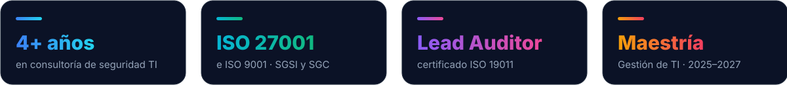
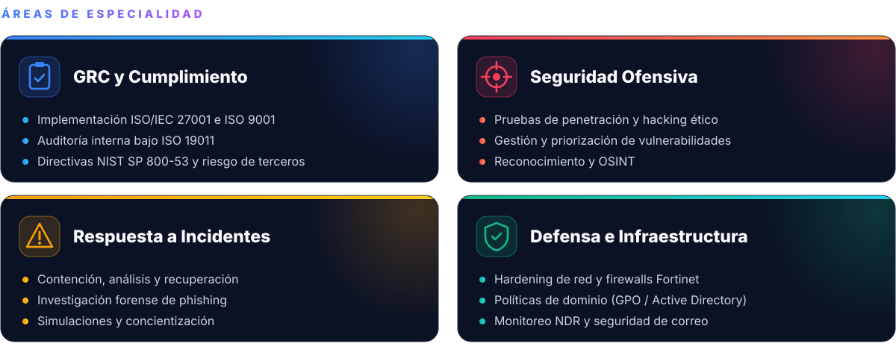
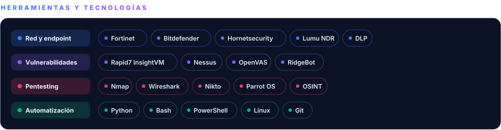
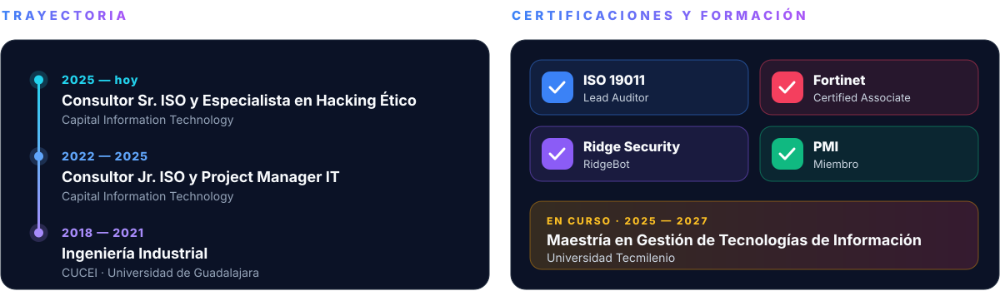

  

&nbsp;

  

Consultor en **Gobierno, Riesgo y Cumplimiento** y **ciberseguridad** en Capital IT. 
Llevo la visión de procesos de la Ingeniería Industrial a la implementación de **ISO/IEC 27001** e **ISO 9001**, 
las **pruebas de penetración** y la **respuesta a incidentes**.

 

  

  

  

  

